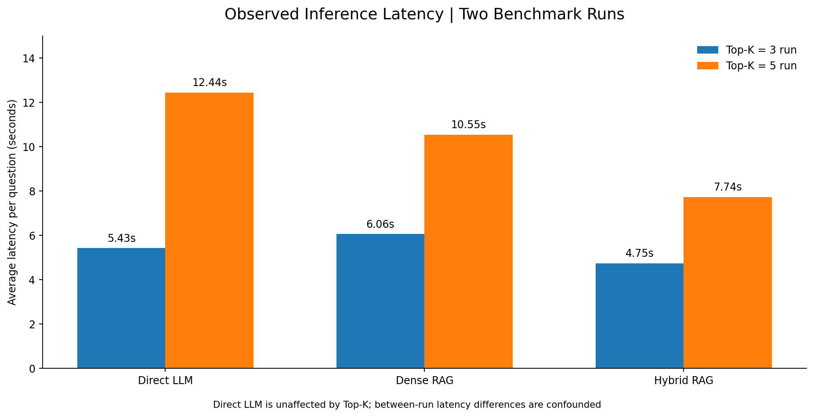

# LLM & RAG Benchmark

**A lightweight, reproducible LLM engineering and LLMOps portfolio project** comparing direct generation with dense, BM25 and hybrid (BM25 + dense, fused with RRF) retrieval-augmented generation (RAG). The project uses a local **Llama 3.2 3B** model via Ollama, versionable experiment configuration, MLflow logging, and a small labeled technical-knowledge benchmark with evidence-level relevance labels.

> **Status:** The published results below come from **v0.1**: two genuine model runs (retrieval `top_k=3` and `top_k=5`), 48 response records per run, with answer-quality labels reviewed and confirmed by a human evaluator. The code is now at **v0.2** (BM25 retrieval, renamed pipelines, chunk-level evaluation schema); v0.2 model runs have not been published yet. This is a small demonstration benchmark, not a production quality claim.

## Version history

| Version | Lexical retrieval | Pipelines | Evaluation data |
|---|---|---|---|
| v0.1 (tag `v0.1.0`) | TF-IDF (unigrams + bigrams) | `direct`, `dense_rag`, `hybrid_reasoning_rag` (TF-IDF + dense RRF, plus splitting compound questions on "and"/"versus") | 16 questions, document-level labels |
| v0.2 (current code) | BM25 (Okapi, `src/bm25.py`) | `direct`, `dense_rag`, `bm25_rag`, `hybrid_rag` (BM25 + dense RRF, no query splitting) | Same 16 questions migrated to an evidence-quote schema; chunk-level metrics |

v0.1 results are kept unchanged in [`reports/v0.1/`](reports/v0.1/) and are **not** results of the current code. To reproduce them, check out tag `v0.1.0`.

## Results at a glance (v0.1)


**Fully correct answers according to human-validated review** (16 questions per pipeline):

| Pipeline | Top-k = 3 | Top-k = 5 | Difference |
|---|---:|---:|---:|
| Direct LLM | 3/16 (18.8%) | 3/16 (18.8%) | 0 pp |
| Dense RAG | 7/16 (43.8%) | 7/16 (43.8%) | 0 pp |
| Hybrid retrieval + query expansion | 8/16 (50.0%) | 6/16 (37.5%) | −12.5 pp |

**Observed mean latency** (seconds/question):



| Pipeline | Top-k = 3 run | Top-k = 5 run |
|---|---:|---:|
| Direct LLM | 5.43 | 12.44 |
| Dense RAG | 6.06 | 10.55 |
| Hybrid retrieval + query expansion | 4.75 | 7.74 |

**Automated diagnostic metrics** (not verified correctness):

| Pipeline | Phrase match K=3 / K=5 | Retrieval hit K=3 / K=5 | Citation proxy K=3 / K=5 |
|---|---:|---:|---:|
| Direct LLM | 6.25% / 6.25% | N/A | N/A |
| Dense RAG | 62.50% / 56.25% | 100% / 100% | 56.25% / 68.75% |
| Hybrid + query expansion | 62.50% / 68.75% | 100% / 100% | 62.50% / 62.50% |

**Important:** `top_k` does not affect the Direct LLM pipeline; its latency changed anyway. Thus the time differences between the runs are **not evidence** that a larger retrieval depth caused slowdown. Repeated, randomized runs and control for machine load would be required.

Full numbers and the per-response human-validated review labels are in [`reports/v0.1/benchmark_summary.csv`](reports/v0.1/benchmark_summary.csv), [`reports/v0.1/human_validated_reviews_k3.csv`](reports/v0.1/human_validated_reviews_k3.csv), and [`reports/v0.1/human_validated_reviews_k5.csv`](reports/v0.1/human_validated_reviews_k5.csv). In these files the hybrid pipeline appears under its v0.1 name, `hybrid_reasoning_rag`.

## What this project demonstrates

- **LLM pipelines:** Compare no-retrieval responses with dense, BM25 and hybrid retrieval, so each retrieval component can be measured on its own.
- **Retrieval engineering:** Word-based chunking with character spans, overlap, sentence-transformer embeddings, a dependency-free BM25 implementation, and reciprocal rank fusion (RRF).
- **Experimentation:** Configurable retrieval depth and decoding settings, per-question outputs, automatically generated summaries, and MLflow experiment records.
- **Evaluation literacy:** Distinguish string-based metrics, chunk- and document-level retrieval metrics (Recall@K, MRR, nDCG, evidence coverage), citation-string checks, abstention, and assessed semantic correctness.
- **Operational practices:** Documented Python modules, pytest tests, GitHub Actions CI, Dockerfile, and local, no-API-key Ollama inference.

## Architecture

```text
            8 original Markdown documents            16 benchmark questions
                         |                         (evidence quotes per question)
              chunk (word windows + char spans)               |
                         |                                    |
        +----------------+----------------+-----------------+ |
        |                |                |                 | |
   Direct LLM       Dense RAG         BM25 RAG        Hybrid RAG
  (no retrieval)  (embeddings)     (lexical BM25)   (BM25 + dense, RRF)
        |                |                |                 |
        +----------------+--------+-------+-----------------+
                                  |
                       Llama 3.2 3B via Ollama
                                  |
        answers + ranked chunk IDs + latency + retrieval metrics
                                  |
                CSV + MLflow + human-validated review labels
```

| Pipeline | Retrieval | Purpose in the comparison |
|---|---|---|
| `direct` | none | Baseline: what the model answers from its own knowledge |
| `dense_rag` | dense embeddings, cosine similarity | Semantic retrieval alone |
| `bm25_rag` | BM25 | Lexical retrieval alone |
| `hybrid_rag` | BM25 + dense ranks fused with RRF (k = 60) | Whether fusing both retrievers beats either one |

Reranking and reasoning-guided retrieval (query decomposition, iterative retrieval) are planned as separate pipelines so that each component's contribution can be measured; none of the current pipelines performs multi-step reasoning.

## Method and experimental settings (v0.1 runs)

| Setting | Value |
|---|---|
| Model / backend | `llama3.2:3b` via local Ollama |
| Lexical retrieval | TF-IDF in v0.1; BM25 (`k1=1.5`, `b=0.75`) from v0.2 |
| Corpus | 8 short, original Markdown notes on LLM engineering |
| Evaluation set | 16 short questions, same set for each pipeline |
| Embeddings | `sentence-transformers/all-MiniLM-L6-v2` |
| Chunking | 100 words, 20 words overlap (configuration defaults) |
| Retrieval depth | `top_k=3` and `top_k=5` |
| Decoding | `temperature=0`, `max_tokens=180` (configuration defaults) |
| Tracking | MLflow, plus local CSV/Markdown outputs |

The benchmark questions and document passages are closely related educational material. Consequently, these experiments show pipeline behavior **on this toy corpus**, not generalization to unfamiliar domains or complex multi-hop production workloads. The selected configurations reflect the project defaults; the published run summaries do not independently capture every environmental variable.

### Human-Validated Answer Quality Evaluation

One human evaluator reviewed and confirmed the correctness labels for all **96 response records** (48 responses in each run) against the benchmark reference answers, using this three-level rubric:

- **Correct:** Direct, materially accurate answer to the question without major factual errors.
- **Partial:** Relevant core fact, but incomplete, hedged with a misleading "insufficient evidence" statement, or containing a material explanation issue.
- **Incorrect:** Fails to answer, gives a substantively wrong answer, or abstains despite clearly available evidence.

This review complements automated phrase matching, which can reject semantically equivalent answers (such as `1/r` versus "1 divided by the rank"). Labels reflect one evaluator's judgment, not a multi-annotator consensus or independently established gold standard. The per-response labels and notes are available in `reports/v0.1/` for inspection. The `summarize_review.py` workflow computes category counts from an annotated CSV and does not itself judge responses.

### What we observed

1. **RAG helped on this document-based benchmark.** Both RAG variants had more answers labeled fully correct than the direct baseline in the two runs.
2. **More retrieved documents did not consistently improve quality.** Dense RAG stayed at 7/16 fully correct; hybrid dropped from 8/16 to 6/16 as `top_k` increased. One or two answers can move percentages substantially on a sample this small.
3. **Lexical evaluation missed meaningful answers.** For example, `1/r` is an equivalent answer to "1 divided by the rank" but fails simple phrase matching.
4. **Retrieval success did not guarantee evidence use.** Some answers still hedged or abstained when relevant passages were returned.
5. **The task needs better reference answers.** Several benchmark references are terse phrases, and a full-accuracy assessment requires checking the underlying documents and definitions rather than relying on literal string matches.

This is **descriptive analysis**, not a statistically significant ranking of RAG architectures. Inference variation, sample size, pipeline differences, and machine state may contribute to observed changes.

## Benchmark schema (v0.2)

Each question in [`data/benchmark.json`](data/benchmark.json) labels its evidence as **exact quotes from the corpus** instead of chunk IDs. Chunk IDs change whenever chunk size or overlap changes, so relevant chunks are derived from the quotes for whichever chunking configuration is being run.

```json
{
  "question_id": "Q004",
  "question": "Which two retrieval methods can RRF combine?",
  "reference_answer": "BM25 lexical and dense semantic retrieval",
  "answerable": true,
  "question_type": "single_hop",
  "relevant_doc_ids": ["rrf.md"],
  "evidence": [
    {"evidence_id": "E1", "doc_id": "rrf.md",
     "quote": "RRF combines BM25 lexical and dense semantic retrieval without needing directly comparable scores."}
  ],
  "evidence_groups": [["E1"]],
  "label_status": "draft",
  "legacy_id": 4
}
```

- `evidence_groups`: each group is one piece of evidence the answer needs (groups are combined with **AND**); the evidence IDs inside a group are alternatives that each satisfy it (**OR**). Single-hop questions have one group; multi-hop questions have two or more.
- `answerable: false` marks questions whose answer is not in the corpus. They take `"question_type": "unanswerable"`, a `null` reference answer and empty evidence fields, and are scored on abstention.
- A chunk counts as relevant to a quote when it contains at least half of the quote's characters.
- `label_status` is `draft` until a human has checked the evidence quotes. The 16 v0.1 questions were migrated with [`scripts/migrate_benchmark_v1_to_v2.py`](scripts/migrate_benchmark_v1_to_v2.py) and are still `draft`.
- [`src/schema.py`](src/schema.py) validates every question on load: quotes must match the document text exactly (whitespace aside), and IDs, groups and documents must be consistent.

## Retrieval metrics (v0.2)

Computed per question from the full ranking, with binary relevance, for answerable questions only:

| Metric | Level | Meaning |
|---|---|---|
| `chunk_recall_at_k` | chunk | Share of relevant chunks in the top K |
| `chunk_ndcg_at_k` | chunk | Rank-discounted gain of relevant chunks in the top K |
| `chunk_mrr` | chunk | 1 / rank of the first relevant chunk (averaged = MRR) |
| `evidence_coverage_at_k` | chunk | 1 if every evidence group has a chunk in the top K (strict multi-hop criterion) |
| `doc_recall_at_k`, `doc_mrr` | document | The same ideas at document level |
| `false_abstention_rate` | answer | Share of answerable questions where the model said "Insufficient evidence" |
| `abstention_accuracy_unanswerable` | answer | Share of unanswerable questions where the model abstained |

## Reproduce locally

**Prerequisites:** Python 3.11, Ollama, and enough memory for `llama3.2:3b`. On macOS, the embedding encoder is configured to use CPU to avoid MPS incompatibilities; Ollama runs independently.

```bash
# Once Ollama is installed, ensure its server is running in another terminal
ollama serve
ollama pull llama3.2:3b

# From this repository's root
python3.11 -m venv .venv
source .venv/bin/activate
python -m pip install -r requirements.txt
python -m pytest tests/ -v

# Model runs create separate timestamped results directories
python -m experiments.run_benchmark --top-k 3
python -m experiments.run_benchmark --top-k 5

# Explore run tracking
mlflow ui
```

If Ollama is already running as a desktop service, do **not** launch a second `ollama serve` process. To run only code-path tests without model inference:

```bash
python -m experiments.run_benchmark --provider mock --lexical-smoke --limit 3
```

**Mock runs are not LLM evaluation and should never be published as performance results.** Model outputs can change across reruns even with temperature zero.

### Review your own run

```bash
python -m experiments.review_answers results/YOUR_TIMESTAMP/per_question.csv
# Fill correctness + notes columns in results/YOUR_TIMESTAMP/manual_review.csv
python -m experiments.summarize_review results/YOUR_TIMESTAMP/manual_review.csv
```

The `results/` folder is intentionally excluded from Git (except `.gitkeep`), so your local experiment files and MLflow databases will not be committed accidentally. Publish **selected, inspected summaries** in a versioned `reports/` folder, as done in `reports/v0.1/`. The human-validated review labels and notes are included for transparency and auditability; they are not a multi-annotator gold standard.

## Repository structure

```text
config.yaml                 # LLM, retrieval (incl. BM25 k1/b), and tracking settings
src/retrieval.py            # chunking with spans, dense / BM25 / hybrid (RRF) ranking
src/bm25.py                 # Okapi BM25, no external dependency
src/schema.py               # benchmark schema validation, evidence -> chunk mapping
src/retrieval_metrics.py    # Recall@K, MRR, nDCG, evidence coverage
src/evaluate.py             # answer-level diagnostics and abstention detection
src/llm.py                  # Ollama / OpenAI-compatible / mock clients
experiments/                # benchmark runner + review utilities
scripts/                    # one-off data migrations
data/documents/             # 8 original educational knowledge notes
data/benchmark.json         # 16 questions with evidence quotes (schema v0.2)
reports/v0.1/               # published v0.1 summaries, review labels, PNG figures
tests/                      # unit tests
.github/workflows/ci.yml    # automated CI checks
Dockerfile                  # portable execution environment
```

## Roadmap

1. **v0.2 (this version):** BM25, renamed pipelines, evidence-level schema and retrieval metrics.
2. **LLM-as-a-judge:** calibrate an automated judge against the human labels with a question-level dev/test split (Cohen's κ, macro-F1, confusion matrix).
3. **Harder benchmark:** 50–100 questions with similar distractor documents, multi-hop and unanswerable questions.
4. **Cross-encoder reranking** as a separate pipeline.
5. **Reasoning-guided RAG:** query decomposition and iterative retrieval as a separate pipeline.
6. **Statistical evaluation:** question-level bootstrap confidence intervals and paired comparisons.
7. **Multi-model comparison:** model capacity versus retrieval strategy.

## License

See [LICENSE](LICENSE) for the project license. The technical-note corpus is original educational material.
