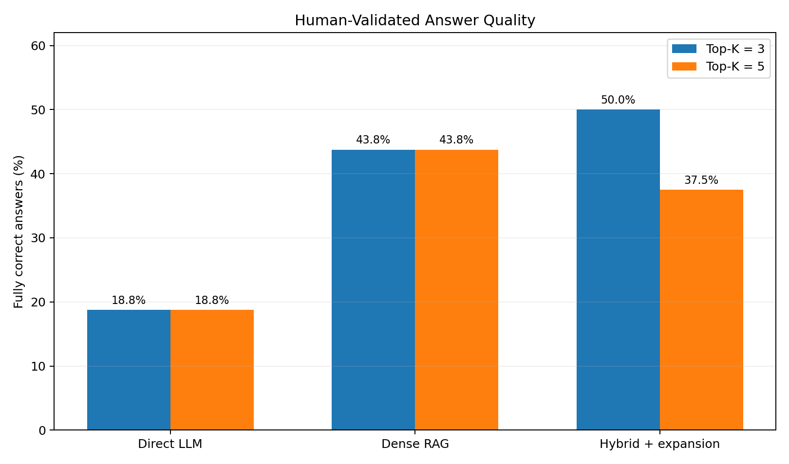

# LLM & RAG Benchmark

**A lightweight, reproducible LLM engineering and LLMOps portfolio project** comparing direct generation, dense retrieval-augmented generation (RAG), and hybrid retrieval with query expansion. The project uses a local **Llama 3.2 3B** model via Ollama, versionable experiment configuration, MLflow logging, and a small labeled technical-knowledge benchmark.

> **Status:** Two genuine model runs completed (retrieval `top_k=3` and `top_k=5`), 48 response records per run. The answer-quality labels were reviewed and confirmed by a human evaluator. This is a small demonstration benchmark, not a production quality claim.

## Results at a glance



**Fully correct answers according to human-validated review** (16 questions per pipeline):

| Pipeline | Top-k = 3 | Top-k = 5 | Difference |
|---|---:|---:|---:|
| Direct LLM | 3/16 (18.8%) | 3/16 (18.8%) | 0 pp |
| Dense RAG | 7/16 (43.8%) | 7/16 (43.8%) | 0 pp |
| Hybrid retrieval + query expansion | 8/16 (50.0%) | 6/16 (37.5%) | −12.5 pp |

**Observed mean latency** (seconds/question):


| Pipeline | Top-k = 3 run | Top-k = 5 run |
|---|---:|---:|
| Direct LLM | 5.43 | 12.44 |
| Dense RAG | 6.06 | 10.55 |
| Hybrid retrieval + query expansion | 4.75 | 7.74 |

**Automated diagnostic metrics** (not verified correctness):

| Pipeline | Phrase match K=3 / K=5 | Retrieval hit K=3 / K=5 | Citation proxy K=3 / K=5 |
|---|---:|---:|---:|
| Direct LLM | 6.25% / 6.25% | N/A | N/A |
| Dense RAG | 62.50% / 56.25% | 100% / 100% | 56.25% / 68.75% |
| Hybrid + query expansion | 62.50% / 68.75% | 100% / 100% | 62.50% / 62.50% |

**Important:** `top_k` does not affect the Direct LLM pipeline; its latency changed anyway. Thus the time differences between the runs are **not evidence** that a larger retrieval depth caused slowdown. Repeated, randomized runs and control for machine load would be required.

Full numbers and the per-response human-validated review labels are in [`reports/benchmark_summary.csv`](reports/benchmark_summary.csv), [`reports/human_validated_reviews_k3.csv`](reports/human_validated_reviews_k3.csv), and [`reports/human_validated_reviews_k5.csv`](reports/human_validated_reviews_k5.csv).

## What this project demonstrates

- **LLM pipelines:** Compare no-retrieval responses with grounded document retrieval and hybrid lexical/semantic search plus lightweight query expansion.
- **Retrieval engineering:** Word-based chunking, overlap, sentence-transformer embeddings, lexical scoring, and reciprocal rank fusion (RRF).
- **Experimentation:** Configurable retrieval depth and decoding settings, per-question outputs, automatically generated summaries, and MLflow experiment records.
- **Evaluation literacy:** Distinguish string-based metrics, document retrieval hit, citation-string checks, and assessed semantic correctness.
- **Operational practices:** Documented Python modules, pytest tests, GitHub Actions CI, Dockerfile, and local, no-API-key Ollama inference.

## Architecture

```text
                8 original Markdown documents
                         |             16 benchmark questions
                  split + embed                |
                         |                     |
   +---------------------+---------------------+-------------------+
   |                     |                                         |
Direct LLM       Dense semantic RAG                   Hybrid lexical + dense RAG
(no documents)   (semantic retrieval)                  (RRF + query expansion)
   |                     |                                         |
   +---------------------+-------------------------+---------------+
                         |
               Llama 3.2 3B via Ollama
                         |
           answers + retrieved IDs + latency
                         |
        CSV + MLflow + validated review labels
```

The `hybrid_reasoning_rag` pipeline name in the code refers to a **lightweight query-expansion / retrieval workflow**, not a guarantee of advanced multi-step reasoning or a separately trained reasoning model. This distinction matters when interpreting the comparison.

## Method and experimental settings

| Setting | Value |
|---|---|
| Model / backend | `llama3.2:3b` via local Ollama |
| Corpus | 8 short, original Markdown notes on LLM engineering |
| Evaluation set | 16 short questions, same set for each pipeline |
| Embeddings | `sentence-transformers/all-MiniLM-L6-v2` |
| Chunking | 100 words, 20 words overlap (configuration defaults) |
| Retrieval depth | `top_k=3` and `top_k=5` |
| Decoding | `temperature=0`, `max_tokens=180` (configuration defaults) |
| Tracking | MLflow, plus local CSV/Markdown outputs |

The benchmark questions and document passages are closely related educational material. Consequently, these experiments show pipeline behavior **on this toy corpus**, not generalization to unfamiliar domains or complex multi-hop production workloads. The selected configurations reflect the project defaults; the published run summaries do not independently capture every environmental variable.

### Human-Validated Answer Quality Evaluation

One human evaluator reviewed and confirmed the correctness labels for all **96 response records** (48 responses in each run) against the benchmark reference answers, using this three-level rubric:

- **Correct:** Direct, materially accurate answer to the question without major factual errors.
- **Partial:** Relevant core fact, but incomplete, hedged with a misleading "insufficient evidence" statement, or containing a material explanation issue.
- **Incorrect:** Fails to answer, gives a substantively wrong answer, or abstains despite clearly available evidence.

This review complements automated phrase matching, which can reject semantically equivalent answers (such as `1/r` versus "1 divided by the rank"). Labels reflect one evaluator's judgment, not a multi-annotator consensus or independently established gold standard. The per-response labels and notes are available in `reports/` for inspection. The `summarize_review.py` workflow computes category counts from an annotated CSV and does not itself judge responses.

### What we observed

1. **RAG helped on this document-based benchmark.** Both RAG variants had more answers labeled fully correct than the direct baseline in the two runs.
2. **More retrieved documents did not consistently improve quality.** Dense RAG stayed at 7/16 fully correct; hybrid dropped from 8/16 to 6/16 as `top_k` increased. One or two answers can move percentages substantially on a sample this small.
3. **Lexical evaluation missed meaningful answers.** For example, `1/r` is an equivalent answer to "1 divided by the rank" but fails simple phrase matching.
4. **Retrieval success did not guarantee evidence use.** Some answers still hedged or abstained when relevant passages were returned.
5. **The task needs better reference answers.** Several benchmark references are terse phrases, and a full-accuracy assessment requires checking the underlying documents and definitions rather than relying on literal string matches.

This is **descriptive analysis**, not a statistically significant ranking of RAG architectures. Inference variation, sample size, pipeline differences, and machine state may contribute to observed changes.

## Reproduce locally

**Prerequisites:** Python 3.11, Ollama, and enough memory for `llama3.2:3b`. On macOS, the embedding encoder is configured to use CPU to avoid MPS incompatibilities; Ollama runs independently.

```bash
# Once Ollama is installed, ensure its server is running in another terminal
ollama serve
ollama pull llama3.2:3b

# From this repository's root
python3.11 -m venv .venv
source .venv/bin/activate
python -m pip install -r requirements.txt
python -m pytest tests/ -v

# Model runs create separate timestamped results directories
python -m experiments.run_benchmark --top-k 3
python -m experiments.run_benchmark --top-k 5

# Explore run tracking
mlflow ui
```

If Ollama is already running as a desktop service, do **not** launch a second `ollama serve` process. To run only code-path tests without model inference:

```bash
python -m experiments.run_benchmark --provider mock --lexical-smoke --limit 3
```

**Mock runs are not LLM evaluation and should never be published as performance results.** Model outputs can change across reruns even with temperature zero.

### Review your own run

```bash
python -m experiments.review_answers results/YOUR_TIMESTAMP/per_question.csv
# Fill correctness + notes columns in results/YOUR_TIMESTAMP/manual_review.csv
python -m experiments.summarize_review results/YOUR_TIMESTAMP/manual_review.csv
```

The `results/` folder is intentionally excluded from Git (except `.gitkeep`), so your local experiment files and MLflow databases will not be committed accidentally. Publish **selected, inspected summaries** in `reports/`, as done here. The human-validated review labels and notes are included for transparency and auditability; they are not a multi-annotator gold standard.

## Repository structure

```text
config.yaml                 # LLM, retrieval, and tracking settings
src/                        # embedding/retrieval, LLM client, evaluation
experiments/                # benchmark runner + review utilities
data/documents/             # 8 original educational knowledge notes
data/benchmark.json         # 16 question / reference pairs
reports/                    # tracked summaries, review labels, PNG figures
tests/                      # unit tests
.github/workflows/ci.yml    # automated CI checks
Dockerfile                  # portable execution environment
```

## Next improvements (deliberately outside this MVP)

Multi-reviewer agreement checks; expanded and held-out questions; more faithful citation verification; paired randomized run order with repeat trials; answer-quality evaluation against richer gold answers; and meaningful token usage/cost measurement.

## License

See [LICENSE](LICENSE) for the project license. The technical-note corpus is original educational material.
